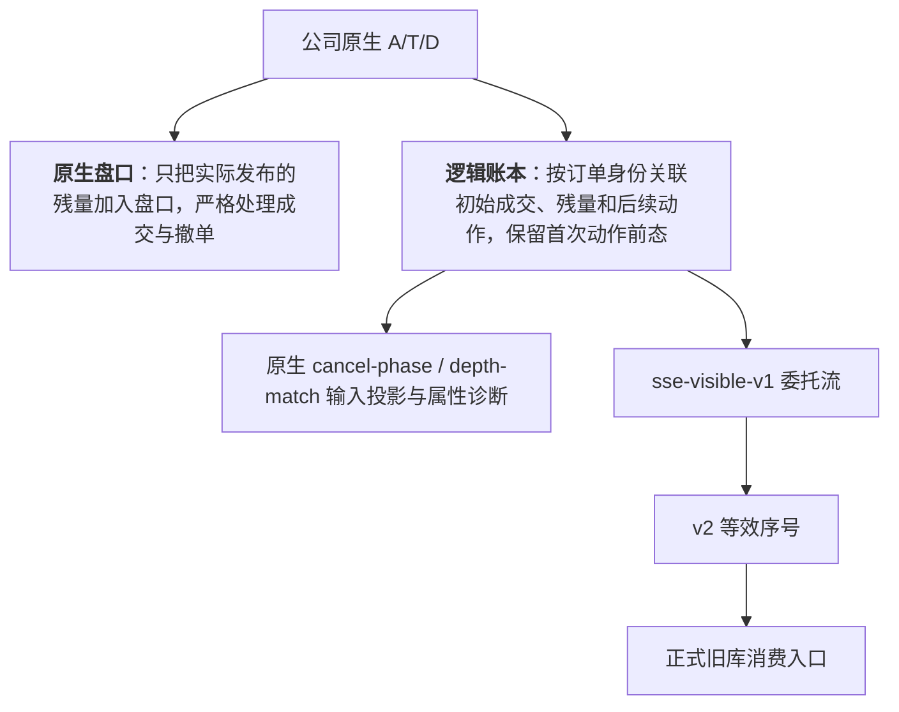

# 还原沪市原始委托：问题、实现与阶段结果

汇报日期：**2026-10-10**。本文系统梳理了本子项目截至目前的业务背景、研究方法、工程实现、实测结果及后续规划，涵盖 9 月开展的真实数据盘口重建与可识别性验证，以及 10 月推进的因子降级实验、委托流适配器、序号时钟、股票池与报价合同建设。

目前，我们已经能够基于公司的沪市逐笔行情精确重建可见盘口，将每笔可见订单的成交、挂单残量与撤单完整关联为逻辑订单，并转换为现有因子引擎可直接消费的委托流。在真实测试样本中，全部 800 张 L2 深度快照均在逐笔流中找到了完全一致的盘口状态。在采用封存的 v2 序号时钟后，R9 全市场模拟往返实验显示：258 个模型特征列中，有 228 列与深市基准的截面秩相关（Rank Correlation）达到了 0.99 以上。

**但受限于交易所逐笔行情本身的信息披露粒度，客观上无法唯一推导所有订单的原始申报限价、原始订单类型以及部分即时撤余（IOC 余量）；因此，“无损还原每一笔原始委托”与“所有原公式零误差迁移”在当前数据条件下并无法成立。** 本次交付的核心，是一套观察口径明确、误差证据闭环、验收边界严密的重建系统。目前，独立沪市股票池、六日报价合同以及 v2 时钟均已封存；沪市专属结构参数标定、核参数标定、真实生产评分、全历史因子重算与策略实盘效果评估目前均尚未启动。

| 交付对象 | 截至 10.10 的状态 | 证据范围 |
| --- | --- | --- |
| 原生盘口回放 | 已实现，真实样本通过严格回放与快照核验 | 覆盖主板、科创板抽样股票日，尚未展开全历史验收 |
| 逻辑订单及因子输入 | 已实现身份关联、数量推导、时间口径、前态及生命周期构建 | 确定属性与未确定属性分别独立落盘保存 |
| 旧因子库委托流适配器 | 已接入正式消费入口，统一采用 `sse-visible-v1` 口径 | 通过深市数据模拟沪市披露；真实沪市评分设有前置阻断检查 |
| 沪市序号时钟 | 默认采用 v2 映射，单位固定为 sequence，以 R1s 为主参照，已封存 | 六日、36 个通道日、108 项硬指标核验全部通过 |
| 独立沪市参考与报价 | 601 日 PIT 股票池与六日报价合同已通过验收 | 覆盖 1,370,521 个股票日，46,032,262 个正报价网格检查全部通过 |
| 沪市独立标定与正式应用 | 已完成方案设计，计算尚未启动 | 严禁借用深市参数，不把模拟往返检验等同于真实效果验收 |

## 1. 问题背景：沪深两市发布的“委托”含义不同

我们现有的高频因子库主要是基于深市逐笔数据的语义逻辑构建的：深市遵循“先报单、后动作”的模式，数据流会先推送原始进场委托，随后才会推送该笔订单对应的成交和撤单。因此，原始报单的数量、限价、订单类型及入场时刻，都能顺畅地进入订单生命周期分析和因子特征计算中。

但沪市在连续竞价阶段的披露机制完全不同：交易所通常先推送主动成交（T）；只有当该笔订单在撮合后仍有未成交的余量时，才会补发一条新增委托（A）。
更关键的是，这条 A 记录的只是挂入盘口的**剩余残量**，而非初始申报量。如果一笔主动订单全部成交、没有产生残量，那么在数据里就只有成交 T，根本不会出现对应的进场 A。如果直接把沪市的 A 表当成深市的原始委托表使用，会在业务逻辑上引发一系列严重偏差：

| 差异 | 直接套用深市代码的后果 | 对研究的影响 |
| --- | --- | --- |
| A 可能是成交后的残量 | 申报数量被严重少算，订单开始时间被强行延后 | 数量匹配、完成率统计、撤单时延及初始盘口判定均出现错误 |
| 完全成交的主动单没有 A | 整笔订单被漏算，或系统误报成交引用缺失 | 订单总样本、统计分母、订单邻接关系及主动行为评分发生系统性偏移 |
| 多笔 T 实际属于同一笔母单 | 每条成交都被误当作一笔独立发起的委托 | 订单总数、订单链结构及主被动配对关系被重复统计 |
| 无残量订单缺失原始限价与报单类型 | 若直接用成交价回填，订单原有的价格意图被篡改 | `dm03/dm04`、部分撤单重挂、队列位置及响应评分失真 |
| 部分即时撤余（IOC）不发布 | 实际观察到的成交量被误认为是完整的申报量 | 导致“恰好按对手一档深度下单”等策略行为的判断被高估 |
| 通道原生序号与发布密度不同 | 相同的序号差值在两市代表截然不同的事件距离 | 消息距离核函数、激进单簇判定、订单链聚合及 F40 门限发生扭曲 |
| 快照发布时间与逐笔业务时间不可直接对齐 | 直接按快照时间截取逐笔消息会得到不一致的盘口状态 | 盘口核验、因果截止点界定与时间序列解释必须分别解耦处理 |

$举个具体例子$：假设某笔订单先在盘口主动成交了 600 股，剩余 400 股挂入买盘，随后被动成交了 100 股、撤单 100 股，最终在盘口留存 200 股。在不考虑隐藏余量的前提下，该订单的真实初始申报量应为 `600 + 400 = 1,000` 股，全生命周期满足严格的数量守恒：`700 成交 + 100 撤单 + 200 在簿 = 1,000 股`。这里需要特别注意，后续被动成交的 100 股本身就来源于首次挂单的 400 股残量，绝不能重复累加到初始申报量中。

如果某笔订单只观察到成交了 199 股且没有后续的 A 记录，我们在数据上能绝对确定的只有其已观察到的成交量。尽管科创板单笔买入最低申报量为 200 股的规则可以从逻辑上证明其原始申报量至少为 200 股，但我们依然无法确定交易者最初报出的到底是 200 股、800 股还是其他合规数量 [S1][S2]。

## 2. 操作思路：先确定可见事实，再测量缺失信息的影响

整个项目按照四层证据链逐步推进，分别解决不同维度的技术问题：

1. **协议与源字段核查**：严格对照交易所业务规则、Level-2 接口规范、公司现有 Doris 数据表以及数据入库血缘，核实交易所到底推送了哪些字段、公司当前读取合同保留了哪些内容。公开资料仅用于理解协议机制，行情的核验完全基于公司既有的真实数据。
2. **真实沪市重建**：直接由原生 A/T/D 驱动原生盘口，再利用订单业务身份将初始主动成交、首次残量挂单、后续被动成交与撤单准确串联。全流程通过数量守恒、被动单引用、价位合法性、FIFO 撮合顺序以及独立快照切片进行严格自检。
3. **可识别性证明**：基于交易所撮合规则，严格证明哪些订单属性能够被数学唯一还原；对客观上无法唯一还原的属性，构造反例证明“在相同可见行情下，存在不同的原始报单输入，导致因子输出产生差异”。每个特征公式均按其实际依赖的数据底料分别确立验收标准。
4. **深市真值对照**：将完整的深市逐笔数据主动降级为沪市口径的可见信息，经过重建与适配后输入现有因子库，并与深市原始无损输入下的因子值进行逐列对比。通过这套对照实验，定量测量信息缺失、价格口径约定以及序号尺度压缩对因子的真实影响。

目前可以直接读取的股票数据源为 `l2.order/trade/cancel`；`l2.tick` 仅是上述三张表的合并视图，是没有引入额外的底层原始消息的。订单、成交和撤单均可完整追溯到原始分片路径、文件哈希和入库行数。在普通股票表中，未能找到保护限价、撤单原因、完整原始指令类型等独立字段；此前核查中未能成功读取公司上游 Parquet 的原始 schema，因此我们只能确认当前数据库缺列，~~不能直接断言公司所有的底层归档数据都缺失~~。对米筐公开接口的核查也证实，其无法补充这些逐笔原始属性 [S3]。

关于原始限价无法唯一还原，存在一个直观的$反例$：假设盘口卖一为 10.00 元、1,000 股，卖二为 10.01 元。此时一笔买入 1,000 股的限价单，无论其申报限价是 10.00 元还是 10.01 元，都会在卖一处完全成交，在沪市数据流中留下完全相同的成交记录与盘口变动。但在旧因子定义下，原 `dm03_price_room` 的得分分别为 0 和 1，`dm04_price_cap` 的得分分别为 1 和 0。这两种原始申报在可见行情上完全等价、无法区分，回放逻辑自然也不可能同时还原两者的原公式得分。

因此，项目在验收上同时设立了**两种标准**：
1. **数学严格证明**用于判定“原始属性或原公式是否能够无损确立”；
2. **截面秩相关**则用于量化“按工程约定重建后，因子的相对排序偏差究竟有多大”。

即使某些因子的截面相关性非常高，其绝对数值在大量股票日上也其实可能已经发生了变化，这两种标准不能互相混淆 [S4]。

## 3. 实现方式：原生盘口、逻辑订单和适配委托流

### 3.1 原生盘口与逻辑账本分开维护



订单在系统中的全局身份定义为 `(交易日, 交易所, 股票, 通道, 原始订单号)`；事件的时间先后则严格依据各通道的原生 `seq`。订单号与事件序号各有独立的业务含义，严禁混用。我们在系统中完整保留原始序号用于溯源，而在向外输出适配流时，另行生成等效序号。

在原生盘口中，A 消息只增加真实挂出的残量，T 消息仅扣减在簿被动单的挂单量，D 消息则按指定订单核减挂单。对于没有 A 消息的主动成交，仅将其归入逻辑账本，绝不向原生盘口虚增任何挂单深度。一旦出现被动订单引用缺失、超额扣减、订单号冲突、价格倒挂或破坏 FIFO 规则的情况，回放程序会直接报错阻断，坚决不通过硬剪数量来掩盖数据异常。

逻辑账本负责将 T→A 识别并串联为同一笔订单，同时为纯 T 成交建立独立的逻辑订单档案，精确记录其首笔成交发生前的盘口状态、两档深度、订单起始点和原生入簿时刻。我们将业务时间、数据接收时间、快照发布时间以及属性在工程上的可用时刻清晰解耦。所有输入统一按照 09:35 实施排他性截断，截断点之后发生的事情或获得的证据，绝不允许向前渗透改变截断点之前的因子计算结果 [S1][S4]。

### 3.2 能唯一推导的属性写入重建层

| 属性或订单情形 | 当前处理 | 证据与边界 |
| --- | --- | --- |
| 先挂单、未立即成交的订单 | 原始数量直接取 A 消息中的申报量 | 交易所直接披露，信息完全透明 |
| 初始主动成交后挂出残量的订单 | 原始数量＝初始主动成交量总和＋首次残量 A 的申报量 | 后续发生的被动成交与撤单均源于该残量，不再重复加总 |
| 纯 T 订单，且最后完成成交后同价位仍有未吃完的对手挂单 | 原始数量＝已观察到的成交量总和 | 依据交易所撮合不变量，对手盘未耗尽即可严格证明该订单已完全满足 |
| 纯 T 订单，且恰好吃空对手一档深度，无残量挂出 | 记录已观察成交量总和，标注为数量下界，状态置为未完全确定 | 无法排除该订单原本包含即时撤余（IOC）的可能性 |
| 源数据精度下的订单进场时间 | 主动订单取首笔成交时间；直接挂单取 A 消息时间 | 严格遵循交易所业务时间口径，不虚构更高精度的接收物理时间 |
| 残量挂单价格越过所有已成交的价位 | 判定为限价单，原限价＝残量挂单价 | 交易所撮合规则与限价申报机制提供充分支撑 |
| 残量挂单价落在最后成交价上，或属于纯 T 订单 | 保留原始订单类型与原始限价的歧义标记 | 残量挂单价或成交极值仅能作为特定观察口径下的代偿值 |

若有外部属性证据引入重建层，必须附带明确的数据源、截断点前的可用时刻，并经过严格的数量、价格、类型与成交约束校验。在当前的真实样本审计中，未向系统注入任何人工合成的伪原始属性 [S1]。

### 3.3 `sse-visible-v1` 为旧库提供可计算的统一输入

为了让旧因子库能够平滑消费数据，适配器为每个逻辑订单生成一行深市格式的标准委托记录，并明确执行以下约定：订单数量优先采用严格证明的原始申报量，若无法证明则采用“已成交量＋已发布残量”；存在残量时限价取残量挂单价，无残量时取最不利成交价；订单类型统一填为 `L`；对于主动订单，将其生成的委托行前置到首笔成交之前，原残量 A 则合并吸纳进同一行中。

需要强调，这里的类型填 `L` 仅属于适配层的数据格式约定，绝不能被业务方解读为“所有订单均是限价单”。未发布的即时撤余也不会凭空捏造出一个精确数值。语义标记 `sse-visible-v1` 会显式贯穿原始表元数据、事件列、进程通信、Parquet 存储以及生命周期，下游消费入口依据该标记选用适配逻辑；而面向沪市原生计算的入口则依然严格遵循残量挂单语义 [S5][S6]。

| 主要代码 | 作用 |
| --- | --- |
| `snapshot/sse_orderbook.py` | 维护原生盘口簿、价位队列、成交与撤单扣量、吃空价位标记及严格断言检查 |
| `algobench/sse_reconstruction.py` | 构建逻辑订单、属性证据链、前态特征、生命周期及两套新因子输入投影 |
| `algobench/sse_order_flow.py` | 生成 `sse-visible-v1` 三表格式，前置补齐进场记录，映射应用等效序号 |
| `algobench/sse_clock.py`、`sse_clock_runtime.py` | 实现各通道原生序号观测、秒边界时间映射、配置管理及缓存唯一身份管理 |
| `snapshot/order_semantics.py`、`events.py` | 负责语义标记的持久化保存与底层事件接口的标准化归一 |
| `formal_panel`、`event_prestate`、`formal_lifecycle` | 负责正式特征面板、前态和生命周期的接入，清晰隔离原生语义与适配语义 |
| `formal_structural_binding`、`run_open5m_raw_bank.py` | 负责沪市独立元数据、九组结构参数及核参数的前置合法性检查 |
| `anchors/sse_reference.py`、`sse_quote_tick.py` | 维护独立的 PIT 股票池、市场参考数据及最小报价单位合同 |

## 4. 真实数据重建已经取得的结果

### 4.1 盘口核验与时间对齐

9 月份的基准测试样本覆盖了主板 600000 与科创板 688981，选取 2024-01-02、2024-07-05、2024-07-08、2026-06-30 四个交易日，合计 8 个股票日、106,849 条逐笔记录，重构出 72,817 个逻辑订单。这批样本全部通过了严格的盘口回放与数量守恒检验。

在比对公司原始保存的 800 张 L2 快照时，所有快照均能在其发布标签时间的前后 3 秒窗口内，找到能够让十档买卖价量、全簿买卖挂单总量、累计成交笔数、成交量与成交金额同时完全吻合的逐笔消息切点；其中 770 张快照找到了全局唯一的匹配切点，仅 30 张快照存在多个候选切点。

在更早一批包含深市对照的 900 张快照核验中，尽管最终也全部找到了对应的物理盘口状态，但若直接按照快照自身附带的标签时间截取逐笔消息，仅有 256/900 张快照能够完全吻合所有盘口字段，且这一偏差无法通过全局平移时间差来修正。因此，快照在系统中主要用于验证盘口回放的正确性与辅助定位，其匹配到的切点时间不会被反向刷写为订单业务时间，也不参与因子计算。现有证据充分证明了样本内可见盘口重建的准确性，但尚未证明快照标签时间与逐笔业务时间在纳秒级上完全对齐，亦未证明全历史范围内的完备性 [S4][S7]。

### 4.2 撮合证明补齐了大部分数量与时间

我们将核查范围扩大至沪市 10 只股票、5 个交易日（共 50 个股票日），并以深市 5 只股票在相同日期的 25 个股票日作为真值基准进行对照检验：

| 核查维度 | 实测取得的结果 | 得出的核心结论 |
| --- | --- | --- |
| 最后一笔成交后同价位仍有挂单 | 深市 1,290,356 笔主动单中，无一例还带有未成交余量；其中包含 16,826 笔市价单 | 在此撮合条件下，纯 T 订单的原始申报量可以数学证明等于成交量总和 |
| 沪市窗口期内纯 T 订单的数量覆盖度 | 133,206 笔纯 T 订单中有 124,610 笔（占比 93.5%）满足上述条件 | 绝大多数纯 T 订单的原始申报量已被严格推导证明；剩余未满足的继续保留为不确定状态 |
| 委托申报与首笔成交的业务时间差 | 深市 1,452,433 笔主动单、沪市 141,738 笔 T→A 订单的时间差吻合度均为 100% | 在源数据时间精度下，完全可以直接采用首笔成交时间作为主动订单进场时间 |
| 残量挂单价格越过已成交价位 | 141,738 笔 T→A 订单中有 22,535 笔（占比 15.9%）满足此特征 | 这部分订单可以严格确认为限价单，且残量挂单价即为其原始申报限价 |
| 逐笔汇总与收盘统计的一致性 | 30 个股票日中成交 1,743,256 笔、撤单 986,148 笔，其数量汇总与快照日终统计误差为 0 | 测试样本内的逐笔数据具备完整的流完备性；快照统计数据同样没有包含即时撤余 |

在这批沪市早盘样本中，共计包含 504,313 笔逻辑订单：直接挂单占 71.7%，T→A 订单占 1.9%，纯 T 订单占 26.4%。在纯 T 订单中，因吃空一档深度而导致申报量无法完全确定的共有 8,596 笔，占订单总量的 1.7%；这一比例在不同个股间存在明显差异，不能作为全市场的固定参数直接套用。此外，2026-06-30 的快照数据中部分撤单统计与挂单笔数字段缺失，该交易日仅针对实际可用的字段进行了严格核验 [S1]。

### 4.3 cancel-phase 与 depth-match 的进展

在将上述撮合推导逻辑引入同一批 8 个股票日后，原生重建链路的实际表现如下：

| 评估对象 | 已取得的实际结果 | 明确的验收边界 |
| --- | --- | --- |
| cancel-phase（48 个方向列） | 每个样本均达到 48/48 列完全可计算 | 沪市未发布的即时撤余与不可见订单依然会对因子的总体统计量造成微幅扰动 |
| depth-match（24 个方向列） | 618,768 个逐单评分单元中有 615,029 个完全确立，比例达 99.4% | 聚合到股票日维度时仅有 23/192 列通过认证，逐单层面的未知数量会向聚合层传导 |
| 纯 T 订单原始数量确立率 | 13,754 笔中有 13,443 笔完全确立，确立率达 97.7% | 仅代表 8 个特定测试样本的表现，不能直接外推为全市场的最终恢复率 |
| 开盘窗口订单申报时间确立率 | 订单未确定数量为 0 | 建立在源数据业务时间精度的协议约定之下 |
| 系统回归测试 | 对应范围内的 270 项测试全部通过 | 工程检查与单测通过不能替代全历史真实数据的最终业务验收 |

值得注意的是，即使逐单评分的确定比例高达 99.4%，只要存在极少数订单歧义，就可能导致股票日维度的整列指标无法通过严格认证——因为统计分母、相邻订单判定以及路径依赖需要全量精准闭环。因此，逐单层面的高完成度不能被夸大宣传为股票日 24 列指标全部无损恢复 [S1]。

## 5. 缺失信息对因子的实际影响

### 5.1 先做可见信息降级，再逐列比较

在深市真值降级实验中，我们主动剔除了沪市不可见的进场委托与即时撤余信息，按照统一约定的规则补齐委托数量、限价与订单类型，因子的底层数学核保持完全一致。实验先在 cancel-phase / depth-match 上验证，随后推向旧 raw-bank 全市场检验：

| 实验批次 | 样本规模 | 实测结果 |
| --- | --- | --- |
| cancel-phase / depth-match 降级 | 3 日×100 股，共 300 股票日 | cancel-phase 48 列最低秩相关为 0.99999；depth-match 多数列 ≥0.9997，dm09 买/卖方向最低为 0.986/0.993 |
| dm03 / dm04 专项检验 | 同上 | dm03 在补齐约定下恒等于 0；dm04 最低相关性降至 0.93–0.94 附近，退化为了 dm01 的近似副本 |
| 旧因子库可见性降级 | 选取 2024-07-08、2025-06-30、2026-06-30 全市场，分别覆盖 2,847 / 2,868 / 2,894 只股票 | 每日均有 231–235 个模型特征列截面秩相关 ≥0.99，均值约 0.995 |
| 原始数据流底层对齐核验 | 2026-06-30 全市场样本 | 与正式因子面板中的全部 2,220 个数值列实现逐值完全一致 |

旧因子库的正式注册表中共有 284 个输出列与 4 个诊断列；模型实际使用的是其中的 258 列。各技术文档中出现的“258 模型列”、“288 正式输出与诊断列”以及“2,220 面板数值列”指代的是不同维度的特征集合，不可混为一谈 [S8][S9]。

将信息缺失检验与慢序号时钟检验综合评估后，我们将用于模型的 258 列特征按其在各项测试中的最低秩相关表现划分为四类：

| 类别 | 列数 | 研究结论与业务建议 |
| --- | --- | --- |
| A | 217 | 在各项检验中的最低秩相关均 ≥0.99，具备极高的直接复用价值 |
| B | 9 | 在纯可见信息检验下 ≥0.99，但在慢时钟检验中表现下滑；依赖精细化的序号尺度映射校正 |
| C | 22 | 最低秩相关介于 0.95–0.99 之间，存在可测量的指标偏差，真实沪市下的特征分布仍需深入核验 |
| D | 10 | 最低秩相关 <0.95，偏差过大，不具备直接复用基础 |

这里需要明确，即便是 A 类特征，也不意味着特征数值完全无差。例如依赖原始限价的 f13/f15，在股票日维度上数值完全一致的比例仅为 7%–11% 左右，但其截面排序极其稳定，秩相关依然接近 0.999。D 类主要包括 f16 的部分分量、f42 的卖方分量、f121 以及 f91；目前的分类仅作为特征可用性筛选，并不代表这些列已完成在真实沪市上的最终验收 [S10]。

### 5.2 隐藏即时撤余：能估规模，不能逐单补真值

科创板买入申报不少于 200 股的硬性要求，以及主板买入整手申报的规则，为我们反推隐藏余量提供了可证明的样本观测窗口。9 月份我们最初在 688981（2026-09-21）中排查出 24 笔全天仅有成交、累计成交不足 200 股且无挂单及撤单记录的买单，累计差额至少达 2,583 股；后续扩大核查又在科创板发现 803 笔不足 200 股的买单，在主板发现 52 笔非整手买单，这些订单均无一例外触发了吃空挂单档位的条件。

10 月份我们基于 50 个沪市股票日、2,165,089 笔主动订单，按照一档挂单深度进行了分层建模估计。测算表明：在“吃空对手一档后停止且未挂出残量”的纯 T 买单中，隐藏即时撤余的比例在科创板约为 9.4%，在主板约为 4.0%。不过该估算依赖“即时撤销行为的使用频率与盘口一档深度大致独立”的理论假设；目前单只股票维度的有效样本仍然不足，尚无法输出可直接用于逐股精细修正的固定参数。

受此影响，depth-match 体系中有 8 个因子、16 个方向列由于默认采用“撮合终止＝恰好成交一档”的统计逻辑，在科创板上可能被系统性高估约 5%–10%，个别交易日的高估幅度甚至可达约 25%。按板块进行截面标准化能在多大程度上吸收这种系统偏差，取决于同板块内各股票间的受扰动比例是否一致，这一点目前尚未得到实盘数据的证实。数据证实，当包含隐藏余量的订单终止撮合时，对手盘下一档往往依然存在深度，因此绝不能通过“未吃满五档”作为排除隐藏撤余的依据 [S2][S11]。

### 5.3 f91、f96 的专门诊断

f91 命名为成交价格集中度，但现有深市代码中的 z06 变量实际读取的是成交记录中买方订单的申报委托价，并排除了委托价为 0 的市价买单。降级实验表明，算法注意力的秩相关高达 0.9996，但 z06 的秩相关骤降至约 0.73，偏差核心正是由于 z06 引起的。如果直接改用实际成交价计算，会破坏现有深市因子的逻辑一致性，需要重新发起模型评估。**因此当前决定：dm03、dm04、f91 暂不在沪市正式实现。**

f96 出现的数值有效与缺失状态对调问题，源于因子中价差有效覆盖率必须达到 80% 的硬门槛，以及旧库采用前一事件状态来代理下一事件发生前区间的约定。三天样本中共有 13 个股票日发生了缺失状态反转，但在双方均有有效值的情况下，秩相关依然稳定在 ≥0.9999。这属于旧库窗口状态时间合同本身的技术局限，本次沪市迁移不宜顺带修改既有的深市因子定义 [S12]。

## 6. 委托流往返检验：从 R0 到 R9

往返检验以深市真实数据作为唯一可信的真值基准：

```text
深市原始三表 → 模拟沪市发布方式 → 沪市重建与适配 → 现有正式旧库 → 对照原始面板

```

模拟器首先剥离主动订单的进场 A 消息，将存在残量的 A 消息推迟至初始成交之后发布；隐去符合实验定义的即时撤余，剔除零成交即撤销的市价单，并完整模拟通道序号的压缩效应。我们在 42 只深市股票的小样本上进行了闭环对账，覆盖 330,845 个逻辑订单，往返失败次数为 0；与理论降级规则相比，数量与价格偏差均为 0（本方最优单约定独立处理），成交身份与数量序列在 42/42 只股票上逐一完全重合，单股计算耗时仅为 0.2–6.5 秒。

后续全市场测试均以 2026-06-30 的 2,894 只深市股票作为实验基准。在 R0 阶段（未开启转换），全量 2,220 个数值列与正式面板实现了逐值完全吻合。

| 实验批次 | 主要实验方案与核心处理 | 模型 258 列中秩相关 ≥0.99 的列数 |
| --- | --- | --- |
| R1 | 仅模拟沪市披露格式，不对序号进行压缩 | 232 |
| R2 | 将通道序号统一线性压缩至 0.62，不做映射校正 | 220 |
| R3 | 维持 0.62 压缩比例，引入全局 1/0.62 系数进行统一校正 | 232 |
| R4 | 不做序号压缩，但将约定限价向激进方向偏移 1 tick，测试价格敏感度 | 228 |
| R5 | 按照 10 秒窗口估算真实流速并压缩，采用全窗口统一单一系数校正 | 212 |
| R6 | 按照 1 秒窗口压缩，采用 10 秒分段粗粒度系数校正 | 221 |
| R7 | 按照 10 秒窗口压缩，采用 10 秒分段对齐系数校正 | 232 |
| R8 | 按照 0.1 秒高频波动压缩，采用 1 秒分段系数校正 | 221 |
| R9 | 按照 0.1 秒逐消息高频压缩，采用 v2 sequence 秒边界映射精细校正 | **228** |

实验证实：静态的单一乘数只能校正均匀压缩；一旦消息流速随时间动态剧烈变化，就必须引入高精度的局部非线性映射。R7 由于压缩与校正的粒度同为 10 秒，无法证明其能够应对更微观的流速波动；而 R8 与 R9 则在极端微观扰动下提供了充分的检验说服力 [S5]。

### R7、R8、R9 的 B 类九列对照

下表记录了各版本对 B 类 9 列特征的截面秩相关（保留六位小数）。字段名已省略共有后缀 `__den_all_orders__win_0930_0935`，全精度数据完整保存在归档 CSV 中。

| B 类特征列 | R7 表现 | R8 表现 | R9 表现 |
| --- | --- | --- | --- |
| f26_aggburst_c 买 | 0.999886 | 0.988207 | 0.996452 |
| f26_aggburst_c 卖 | 0.999973 | 0.988212 | 0.993516 |
| f27_childseq_c 买 | 0.999917 | 0.987596 | 0.995618 |
| f27_childseq_c 卖 | 0.999936 | 0.986179 | 0.992796 |
| f30_longrun_c 买 | 0.999873 | 0.980199 | 0.986854 |
| f30_longrun_c 卖 | 0.999800 | 0.986035 | 0.990075 |
| f31_hcrun_c 买 | 0.999568 | 0.967116 | 0.972661 |
| f31_hcrun_c 卖 | 0.998011 | 0.979448 | 0.982256 |
| f122_cancel_impact_abs_250ms 卖 | 0.992051 | 0.991423 | 0.991931 |
| 达到 0.99 的列数 | 9/9 | 1/9 | **6/9** |

在 R9 方案下，A 类的 217 列特征全部达到了 0.99 以上；B 类 9 列的最低相关为 0.972661，中位数达到 0.991931。其中 f30 买方、f31 买卖双方仍略低于 0.99。**因此决定：B 类九列予以保留，但必须严格附带 XSHG、`sse-visible-v1` 以及 v2 sequence 时钟的口径声明。** R9 的实测表现支撑了时钟封存的结论。此前讨论的针对 f16/f42 的限价约定加权方案，未纳入正式实现。

在 R9 运行的 2,889 条转换记录中：2,888 条平稳成功，仅股票 302132 因底层缺失被动订单引用而回退到了兜底降级规则；另有 5 只股票因无有效交易记录而未产生转换，已完整记录在清单中。在 f96 上，R7/R8/R9 在买卖两列各出现 5 处有效/缺失状态差异，而 B 类特征的缺失状态差异严格为 0。所有相关性统计均基于双方共同具备有效值的样本计算，未对缺失值做填零处理。

需要说明的是，R9 沿用了深市的原始时间戳，并以深市通道序号作为基准来构建包含 301 个秒边界节点的 v2 映射结构。虽然它完整复用了封存算法及单位合同，但不能把真实沪市六通道的参数直接硬套在模拟流上，亦不能借此验证沪市真实的开盘发布空窗、参考数据精度或交易行为差异。本实验仅评估因子数学输出的一致性，尚不包含真实沪市环境下的 IC 表现、模型预测能力或策略回测收益 [S5]。

## 7. 序号时钟：采用 v2 秒边界映射并封存

### 7.1 为什么需要独立的时钟合同

高频因子中大量使用的“消息间隔数”，在底层实际依赖的是通道原生序号差，其中天然混入了同通道内其他股票的交织消息。沪市一方面由于缺乏主动订单进场消息导致序号增长偏慢，另一方面各通道的流速极不均匀。以 2026-06-30 为例，全窗口内沪深两市的消息流速比约为 0.536；而在开盘前两秒内，按 1 秒分段计算的比值剧烈波动至 0.022 和 0.009。如果仅仅在个股内部补齐委托行，或者简单乘上全窗口平均系数，都会彻底破坏事件间相对距离的物理含义。

如果粗暴地按照后一条消息所在秒的流速系数去缩放整段序号差，会导致跨秒区间的事件距离全部按右端点的流速被错误放大或缩小。尤其在开盘流速急剧跃升的阶段，这种误差不仅会扭曲短间隔事件，还会向长距离核函数及 F40 门限持续传导。因此，在时钟一致性核验中，我们采用在同一物理时间戳下截取最后序号的“时间戳相邻”判定方式，并以换算后的距离总和与理论参考距离总和的比值作为硬约束，单个区间的比值分位数仅作为辅助诊断指标 [S13]。

### 7.2 v2 的方法

针对沪市的各个数据通道，基于正式股票池内的全量三表事件，采集每个整秒边界上的原生序号 $S_k$。同时，在深市对应的参考通道中筛选开盘前成交最活跃的 3 只基准股票，拟合其通道序号曲线以测算每秒标准流速，取通道中位数累加为深市等效消息基准 $Z_k$。

v2 以各整秒节点 $(S_k, Z_k)$ 为锚点，在相邻节点间按原生序号做分段线性插值映射 $E(S)$，两点间的逻辑距离定义为 $E(S_2) - E(S_1)$。默认以 1 秒为切分边界，各通道构建 301 个节点；边界以外的两端区间采用全窗口平均系数做线性外推。适配层完整保留委托前置补位机制、映射后的整数唯一性保证以及 09:35 排他性因果截止。单位严格锁定为 **sequence**，若配置为 `messages` 入口会强制抛出异常。

### 7.3 验收结果与短距离限制

以秒内均匀分布的 R1s 作为核心参照基准。设定的硬性验收红线为：每个通道日在全窗口内的总距离换算偏差不得超过 2%；开盘后处于 $[10, 60)$ 秒与 $[60, 300)$ 秒区间的子时段合计距离偏差不得超过 1%。在“6 个交易日 × 6 个通道 × 3 项核验”共计 108 项测试中，全部一次性通过。所有核验完全基于现存的距离矩阵与时段汇总数据，未向生产数据库新增任何查询。

| 日期 | 全窗口 v2/R1s 六通道比值范围 | [10,60) 秒合计比值范围 | [60,300) 秒合计比值范围 |
| --- | --- | --- | --- |
| 2024-01-02 | 0.995181–0.999805 | 1.000802–1.002171 | 0.999874–0.999990 |
| 2024-06-12 | 0.992011–1.009235 | 0.999640–1.002220 | 0.999948–1.000027 |
| 2024-07-05 | 0.990417–1.004808 | 0.999062–1.001852 | 0.999940–1.000047 |
| 2024-07-08 | 0.991547–1.000222 | 0.998920–1.001545 | 0.999908–1.000040 |
| 2024-08-06 | 0.990857–1.002974 | 1.000324–1.001849 | 0.999915–1.000158 |
| 2026-06-30 | 0.992398–0.997030 | 1.000808–1.001359 | 0.999974–1.000141 |

超短事件跨度、开盘 $[3, 10)$ 秒、前 3 秒以及 R100 高频参照下的微观波动，明确列为系统的已知局限，不设为阻断封存的红线。这一决策源于基准数据自身的测不准边界：针对完全相同的 v2 映射，若切换至每 0.1 秒统计的 R100 基准，10 秒之后的同秒档比值区间会从 0.9966–1.0150 变为 0.9721–1.0008，1–10 秒档则从 0.9897–1.0032 变为 1.0007–1.0375。因为单通道仅选取 3 只活跃股票作为事件样本，其秒内物理时刻估计本身就存在约 ±4% 的固有不确定性，去追求 2% 以内的微观拟合已经超出了数据源的真实信噪比。而在 10 秒之后的稳态区间，两种映射方式与两种参照基准的时段总距离偏差均牢牢收敛在 0.9989–1.0036 之间，足以支撑秒级以上的特征计算。

沪市在每日开盘初期存在约 0.3–1.8 秒的数据发布静默空窗，在此区间内无法依靠客观消息确定真实时间点。v3 尝试人为强制插入空窗端点，但这引入了额外的经验假设；六日回测表明 v3 未能带来显著的精度提升，反而放大了部分通道在前 3 秒内的换算偏差。**因此，系统正式封存并采用 v2；v3 的相关实现与测试仅保留为可选配置。** 在 06-30 样本中，$[3, 10)$ 秒区间的通道 1 与通道 2 比值仍为 1.0302 和 1.0309；我们在工程上明确声明：秒级以内的超短距离不具备事件级的绝对精度保证 [S14]。

封存配置 SHA256：

```text
dd754f532fba25e7474c783479c75b7ac12c08a5b71700ab5c8ae79ebbcd6f75

```

配置文件中明确声明 `mapping=v2`。当前底层的序列化 schema 标识仍为 `sse-sequence-gap-clock-v3`，但这仅代表缓存数据结构与契约接口的版本号，不代表启用了 v3 映射逻辑。缓存系统采用严格的指纹绑定机制，将映射版本、输入数据哈希、工程代码版本、股票池清单及配置字节完全锁定，任何旧版本或指纹不合的缓存均会被强制拒绝复用。

在 06-30 的单时钟验证（clock-only）中，直接复用现有的三表与参考数据，核心计算阶段耗时 33.475 秒，全流程守护调用总耗时 143.877 秒，内存峰值 3.167 GiB，全过程新增数据库查询为 0。全流程调用耗时中包含了大体量基准参考数据的加载与进程初始化开销，评估运行成本时必须以全流程耗时为准 [S14]。

## 8. 正式股票池、报价单位和工程验收

### 8.1 XSHG 独立点时点参考

我们构建了独立的 `xshg-pit-reference-v1` 参考数据集，完整覆盖 2024-01-02 至 2026-06-30 期间的全部 601 个交易日，共计 1,370,521 个股票日。成分股严格按照当日的证券类型、交易所归属及实际上市/退市周期动态确立；主板与科创板严格隔离，689009 CDR 明确排除在普通 A 股股票池之外。ST、停牌及新股状态实行独立打标管理，个股停牌不改变其成分股归属。

601 个交易日的交易日历与米筐完全一致，抽查的六个关键交易日中的普通 A 股成分集合与米筐双向比对完全一致。以 06-30 为例，正式成分股为 2,310 只，其中 14 只是全天停牌且成交量为 0 的个股（无早盘 L2 数据）；因 L2 包含 689009 CDR，代码扫描共发现 2,297 只标的，正式时钟最终精准吸纳了具备有效 L2 数据的全部 2,296 只普通 A 股。

上市首日、退市整理期首日、摘牌、ST 状态变更以及 CDR 标的均完成了专项穿透抽查。需要强调，数据商打标的 ST 状态与二级市场实际执行的交易风控生效日存在细微交错；日终总成交量仅能作为日后回溯可交易性的参考，绝不能偷渡作为当天 09:35 之前的已知特征。系统严禁将状态缺失默认为正常状态，在本次审查中，全区间的 ST 与停牌状态未知项严格为 0 [S15]。

独立参考 manifest SHA256：

```text
a0e36df4a67fd4672227b0c3ab98b7bfb81f63f083126359ab00563297fd3ce5

```

### 8.2 六日报价合同

样本周期内人民币普通 A 股的法定最小报价单位严格为 0.01 元；交易所规则生效周期、固化 SDK 凭证、点时点成分信息、退市首日特殊规则以及原始文件校验哈希共同构成了报价缓存的防伪指纹。一旦超出法定规则有效期，系统严禁无感默认延用。

抽检的六个交易日与时钟复验周期保持一致，覆盖了 2024 上半年、2024-07-08 调整窗口、两只科创板新股上市首日以及 2026-06-30。针对 00:00 至 09:35 截断点内的 order/trade 全部 46,032,262 个有效正报价进行离散网格核验，校验失败次数为 0。对于 2024-01-02 等历史阶段 L1 连续参考数据覆盖不足的情况，我们在工程上如实记录，依托官方交易规则、底层 SDK 以及高频 L2 网格多维交叉兜底，不虚报所谓的“完整 20 日连续历史”。

**特别说明：完成 601 日的股票池构建，不等于完成了 601 日的全量 L2 报价扫描。** 报价合同目前仅对通过严格核验的六个交易日做出了生产级承诺，全周期剩余的 595 个交易日缓存将在后续启动具体计算时按需补充生成 [S15]。

### 8.3 正式入口接入与深市不变性

正式的旧因子计算框架已全面支持识别适配器语义、XSHG 专属股票池以及独立报价合同，并在向数据库发起取数前，前置校验沪市独立参数的完备性。针对 600000 的试运行在预检阶段被系统主动阻断——原因正是由于检测到底层独立元数据与九组结构参数尚未就绪，系统严格拒绝借用深市参数垫底，成功拦截了非法的实盘评分取数。

在工程回归验证中，针对 000001 和 300750 两个深市基准股票日，288 个正式输出特征列与诊断列均实现了逐值完全一致，最大绝对误差为 0，NaN 分布完全同步。参考数据层面，抽检核对了 10 个深市历史参考与面板文件的哈希值，全部保持绝对不变。目前的回归覆盖了 2 个标准股票日、部分跨年度配置文件及完整面板，尚未推及全历史的逐文件验收。

各项工程测试均有严格记录：9 月份重建相关的 270 项回归测试全部通过；10.09 工程架构 Linux 检查 187 项全部通过；10.10 针对参考与报价模块的 24 个代码文件，Windows 环境通过 411 项（1 项合理跳过），Linux 环境通过 412 项；封存映射与适配器最新的 4 个核心文件在 Linux 下通过 41 项单测。这些测试覆盖了不同研发阶段与代码边界，不可简单相加拼凑为单一的总体覆盖率指标 [S1][S6][S15]。

## 9. 业务运行、资源与可复现材料

最近开展的时钟校验、参考构建及 R9 往返实验均在开发机 **wenjie** 上独立执行，wangly 机器未做访问与代码同步。所有原始 Level-2 行情数据均严格保留在公司生产服务器上，本文汇报所引用的所有本地材料均为特征汇总、指纹配置、比对日志与运行审计凭证。本次汇报整理期间未向数据库发起新查询，亦未启动任何大规模计算、参数拟合或测速任务。

| 已完成的研发阶段 | 实际运行性能与资源开销 | 明确适用的边界限制 |
| --- | --- | --- |
| 8 股票日原生输入深度审计（9.23） | 守护阶段耗时 33.39 秒，内存峰值约 0.514 GiB | 属于基础输入与快照切片审计，不可直接代表旧库全市场运行性能 |
| 300 股票日新因子降级实验（9.29） | 运行耗时约 229 秒，内存峰值约 2.0 GB | 依赖深市较为完备的订单结构，对隐藏撤余的压力测试有限 |
| 旧因子库三日全市场降级测试（10.07） | 单日耗时 216–513 秒，内存峰值 18.6–42.9 GiB | 属于纯信息缺失敏感度实验，未覆盖真实沪市环境参数 |
| 沪市全周期参考数据追加（10.10） | 增补 597 日，执行耗时 177.333 秒，守护总耗时 182.043 秒，内存峰值 626.11 MiB | 仅处理 L1 级别的参考数据，不包含全周期 L2 行情与因子重算 |
| v2 时钟配置独立生成（clock-only，10.10） | 核心计算 33.475 秒，全流程耗时 143.877 秒，内存峰值 3.167 GiB，0 数据库查询 | 仅用于生成并固化 06-30 的映射配置 |
| R9 正式往返实验完成批次（10.10） | 入口耗时 719.310 秒，全流程守护耗时 731.910 秒，内存峰值 36.816 GiB | 严格受限于 100G/16 核配额，并发配置为 parser=4、compute=12、内部线程=1 |
| R9 同批次进行的另一完整取数批次 | 守护总耗时 1,131.991 秒，内存峰值 37.561 GiB；未正式产出日终面板 | 已经真实消耗了算力与取数资源，评估总成本时必须如实计入 |
| R9 因子面板逐列快速比对 | 耗时 4.896 秒，内存峰值 0.521 GiB，0 数据库查询 | 仅读取并比对已经生成的持久化面板数据与日志 |

下表系统梳理了各独立实验阶段产生的物理取数开销。由于各阶段的查询字段与样本跨度差异较大，早期未做精细埋点的审计开销不再人为估算拼凑全周期总数：

| 实验阶段 | 涉及市场与数据类型 | SQL 查询次数 | 网络传输字节数 | 实际拉取行数 |
| --- | --- | --- | --- | --- |
| 正式 601 日参考数据构建 | XSHG L1 | 4,808 | 299,545,582 | 5,484,488 |
| 参考模块小样本代码试跑（单独列支） | XSHG L1 | 32 | 109,808 | 2,028 |
| 五个增补交易日报价合同扫描 | XSHG L2 | 275 | 1,355,367,805 | 36,071,220 |
| 五个交易日时钟四字段增补提取 | XSHG L2 | 158 | 1,448,945,850 | 36,059,945 |
| 同期五日深市基准 top3 股票准备 | XSHE L2 | 195 | 1,938,904,097 | 44,611,823 |
| R9 两次大规模取数计算合计 | XSHE L2 | 166 | 4,476,754,268 | 65,501,712 |
| v2 矩阵验收、时钟生成、R9 比对及方案梳理 | 沪深全市场 | 0 | 0 | 0 |
| 本次工作汇总与文档撰写 | 沪深全市场 | 0 | 0 | 0 |

需要指出：正式参考数据的 4,808 次查询已经包含了全市场预跑的全部开销，不能重复累计；报价模块早期有少量试验性查询的审计日志不全，未混入精确统计中。R9 的 166 次查询全部面向深市模拟数据，对沪市数据库的新增查询严格为 0；在拉取的记录中，有效保留行数为 57,545,850，超出计算预算主动丢弃的 7,955,862 行也作为实际 I/O 开销如实计入。此外，针对米筐的数据对账调用（7 次日历及成分 RPC、1 次 ST 状态 RPC）均属于轻量接口交互，未计入 Doris SQL 的统计中 [S5][S15][S16]。

当前所有计算入口严格遵循“单日按代码区间分页、SQL 仅负责流式取数、核心业务交由 Python 处理”的设计规约，强制执行数据库查询锁、单次传输字节阈值控制与守护进程监管；单个账户硬性限制为 16 核 / 128G 内存，任务内存管控上限 100G，并在交易日 08:50–09:35 高峰时段主动避让停机。早期研究报告中记载的部分数据库端直接聚合 SQL 属于特定阶段的分析脚本，后续生产级运行必须按照现行规约统一封装，严禁直接拼装未经审查的大查询。

R0–R8 的所有实验源码均已通过 Git bundle、补丁包、防伪哈希及恢复说明完成了标准化冷归档；R9 实验即是通过该归档在临时 detached 环境下精准恢复并运行的，运行结束后立即清理了全部 6 个临时中间目录，完整保留了持久化结果、依赖环境与审计凭证。所有的原始时钟映射文件与市场参考数据均妥善落盘，具备 100% 的可复现能力 [S5][S17]。

| 关键资产名称 | 在 wenjie 上的持久化存储绝对路径 |
| --- | --- |
| 原生盘口重建审计资料 | `/home/wenjie/hdd-store/outputs/sirui/sse-reconstruction-20260923-004/` |
| 订单数量推导与规则核验证据 | `/home/wenjie/hdd-store/outputs/sirui/sse-origin-review-20260929-*` |
| 独立 XSHG 参考数据包 | `/home/wenjie/hdd-store/outputs/sirui/algobench/anchors/raw/reference/XSHG/v1/` |
| 六日报价合同及参考验收凭证 | `/home/wenjie/hdd-store/outputs/sirui/sse-formal-reference-20261010/` |
| 已封存的 v2 时钟配置文件 | `/home/wenjie/hdd-store/outputs/sirui/sse-clock-v2-seal-20261010/clock-only/sse-clock/2026-06-30/clock.json` |
| 往返实验标准化工程归档 | `/home/wenjie/hdd-store/outputs/sirui/sse-adapter-roundtrip-20261008/run-logs/experiment-archive-20261009/` |
| R9 最终完成批次结果面板 | `/home/wenjie/hdd-store/outputs/sirui/sse-adapter-roundtrip-20261008/rt-tv100ms-sealed-v2-2026-06-30/` |

工程封存的默认代码提交版本为 `49ad013c3d6474094d58251e9eeaec9508182fd8`，R9 结果产出的代码版本为 `ccadbf7bb3ef11a212ef0e3fc3e21f116019ff7b`，参数标定方案的设计提交为 `bcc6bea04dd8f2a361ba3fe5c75ef9797fe18094`。对应的基础代码均已并入 GitHub main 分支并在本地同步；具体各模块运行的精准版本以其附带的执行签名凭据为准（如 clock-only 运行版本为 `206a63f6d001f3e004737b01ea38509344aaaaaf`）。本次工作仅新增本篇总结汇报文档，未在生产代码库中产生任何新的 commit、push 或部署动作，未向任何服务器发起更新。

## 10. 尚未解决的问题及下一步

| 遗留技术难点 | 对高频因子的实际影响 | 既定的应对方案与待办工作 |
| --- | --- | --- |
| 完全成交的主动订单缺失原始限价与订单类型 | 导致极少数依赖该属性的原公式输出无法唯一确定 | 明确采用统一的可见口径进行代偿；dm03、dm04、f91 明确不在沪市实现 |
| 吃空档位后隐藏的即时撤余，以及零成交不可见订单 | 导致推导的申报总量、订单样本总体及计数类因子存在局部偏差 | 建立完整的证据状态追踪与宏观规模估计；严禁在逐单层面主观猜测伪真值 |
| 沪市真实的委托交易习惯与科创板流动性结构差异 | 深市数据模拟的结果可能在一定程度上低估了沪市的真实误差 | 严格按照沪市不同的板块分类、活跃度分层以及时间窗口进行真实分布抽样核验 |
| 秒内微观序号的相对位置，以及开盘初期的发布空窗 | B 类中有三列特征在 R9 高频扰动下秩相关依然低于 0.99 | 保留九列特征但明确声明时钟口径；对短距离区间的微观拟合误差如实披露 |
| 快照附带的标签时间与逐笔业务时间无法高精对齐 | 无法单纯依赖快照的发布时间戳来精准截断逐笔流 | 系统完整保留候选的物理切点；快照核对结果严禁反向污染因子的时间戳 |
| 真实全历史盘口、订单生命周期与特征的覆盖度 | 抽样样本检验通过不能线性推导为全历史完全可用 | 待取得资源授权后，按照交易日与个股特征进行分层抽样、梯度扩充验证 |
| 缺乏沪市真实的专属结构参数与核参数 | 正式计算入口的前置断言校验被强制阻断 | 优先独立标定六组核参数，继而拟合九组结构参数；坚决禁止回退套用深市参数 |
| 因子在沪市真实环境下的预测能力与策略表现未知 | 高秩相关仅能证明数学计算一致，无法证明实盘交易价值 | 待底层输入与专属参数通过验收后，正式申请开展生产评分、模型训练与策略评估 |

### 10.1 独立沪市标定方案已写成，尚未运行

我们已经完成了沪市独立参数标定的整体方案设计。建议的推进顺序为：首先提取 XSHG 基础元数据与完整三表数据 → 开展沪市六核的前置校验与特征分档 → 独立拟合六核参数并固化股票日参数表 → 进行高频结构观测并建立 F40 门控分阶段事实 → 最终完成九组核心结构参数的归约与验收。其中，六核涵盖时间、序号、数量、价格、BBO 以及 marketability；九组结构参数则包含 f16 优先尺度、f31 瓶颈门限、F40 门控门限、$\lambda_{40}$、$\lambda_{42}$、f85 深度尺度、$\lambda_{RV}$、z12 双侧深度尺度以及 p03 恢复尺度。

在具体分层机制上，个股层面的分组基于 $t-1$ 日的历史特征，对比个股等权等频分档与预测中心分档的效果；市场层面的活跃度分级则严格采用沪市自身上一交易日普通 A 股的总成交笔数。虽然深市开发的分组算法、统计估计模型以及调度框架可以完全复用，但具体的分档阈值、回归系数、核尺度、关键结构参数以及兜底中心值，必须完全基于沪市真实数据独立估计得出。对于 f85 和 z12 结构参数，首版方案建议按照 `XSHG × (Main/STAR) × liquidity` 的多维矩阵进行分组，初期流动性维度显式指定为 `global`；若遇到低样本支持度的情况，仅允许在沪市内部层级向上回退，绝不跨市场借用深市参数。

现有的六日报价缓存可以直接复用，但这六个交易日目前均缺少标定所需的全部三表字段。现存的 `full/` 时钟目录主要为了满足轻量化需求，仅持久化了序号、通道、代码、时间与价格五个基础字段，缺少了报单数量、买卖方向、订单关联标识等关键属性，绝不能仅凭目录名称误判其为全量委托流，亦不能在后续通过行号或时间戳去硬性拼接不同维度的窄表数据。正式执行前，还需要系统核对 L1 实际成交笔数、至少 20 个交易日的 $t-1$ 历史特征基准，以及来自米筐的衍生特征来源。

在推进节奏上，强烈建议采取小步慢跑的策略：先以 2026-06-30 的 600000 单股作为最小跑通单元，随后扩充至 12 只具有代表性的锚点股票，进而覆盖主板 30 只、科创板 12 只代表性标的，在 2024-01-02 与 2026-06-30 两个典型交易日（共 84 个股票日）完成两轮全流程验证；全面通过后，再进一步扩大至 6 个交易日的 252 个股票日样本。42 只代表性股票名单及指纹标识已经在方案中严格固化，目前整个标定流程尚未正式启动运行。

若参照深市已测算的单股票日资源开销进行机械式理论外推，完成上述结构参数测算阶段约需 14.0883 个机时；但这一外推没有计入沪市特有的盘口重建计算、全字段大体量 I/O 取数、前置合法性检查以及沪市专属的统计估计开销，不能作为最终的交付工期承诺。在具备现成面板数据的前提下，六核模型的最终拟合外推耗时约为 12.95 分钟，同样未计入底层 L2 行情与米筐特征的提取耗时。本次工作未为上述理论外推启动任何实际的测速任务 [S16]。

### 10.2 待授权清单

为了推动项目进入下一阶段，现梳理出需要业务与工程团队明确授权的审批清单，建议按步骤依序推进：

1. **底层工程支持授权**：实施并部署针对沪市数据流的前置校验阻断器、参数管理容器、股票日参数数据表、高频结构采样器及参数合规校验器。
2. **全字段数据提取授权**：在严格明确任务日期区间、股票池名单、提取字段集合、SQL 查询次数上限及网络传输字节配额的前提下，从生产库补齐所需的全量三表字段、L1 历史参考数据及米筐配套特征；同时将剩余五个交易日的 v2 时钟配置生成正式纳入执行计划。
3. **分阶段试跑计算授权**：依序批准“单股验证”、“12 股基准锚点”、“两日 42 股样本”的取数、盘口重建及样本特征提取任务；在每个里程碑分别就计算资源消耗与统计科学输出进行独立评审；六核拟合与结构参数估算的单项耗时需单独建账考核。
4. **统计方案与模型审查授权**：组织团队审阅沪市特征分组设计、低支持度回退机制、选样时间跨度及样本尾部覆盖度的合理性，审查通过后依次授权启动六核参数估计与九组结构参数拟合。
5. **生产级全量阶段授权**：在完成阶段性标定验收后，另行独立评估并审批全量 601 日的全面标定、真实沪市生产特征计算、全历史因子重算、下游模型增量训练及实盘策略回测部署任务。

## 11. 项目推进记录与来源

| 日期 | 核心攻坚重点 | 沉淀的阶段性交付成果 |
| --- | --- | --- |
| 09.22 | 原生回放逻辑实现、源字段审查、逻辑订单抽象与原公式依赖梳理 | 明确原生盘口与逻辑账本分离架构；建立严格盘口断言；给出价格不可识别经典反例；界定底层档案读取边界 |
| 09.23 | 正式重建数据投影、真实环境快照对齐与公开技术文档核实 | 8 股票日、800 张快照精准对齐核验；给出纯 T 数量反例；确立初始申报量严禁重复累加的业务逻辑 |
| 09.29 | 撮合理论证明、数据完备性统计、特征降级测量实验 | 证明绝大多数纯 T 数量与业务时间对齐；实现 48 列相位指标全量计算；完成 300 股票日新因子降级误差评测 |
| 10.07 | 旧因子库全市场降级检验与慢序号时钟影响评估 | 建立 258 列模型特征的 A/B/C/D 分类标准；实现原始数据流与正式生产面板的逐值完全吻合 |
| 10.08 | 统一委托流适配器开发、R1–R8 往返验证、隐藏余量及异常列专项诊断 | 产出统一委托流；量化序号压缩与限价敏感度影响；界定不可实现列及底层观察边界 |
| 10.09 | 正式旧库工程接入与独立参数前置阻断检查部署 | 验证深市特征逐值完全不变；实现沪市未就绪状态下的安全阻断；完成全套实验代码的无损归档 |
| 10.10 | 序号映射算法优化、六日多维复验、股票池与报价合同验收、R9 往返落地、标定方案成型 | 正式封存 v2 时钟；完成 601 日参考与六日报价合同生产验收；R9 达成 228/258 达标；产出独立标定方案 |

本文引用的所有数据指标均严格溯源自下列研发报告及其配套的原始日志证据目录。报告中记录的历史研发状态均按上述时间线进行解释；当前系统采用的正式工程规范与基准结论，严格以已封存的 v2 时钟合同、R9 往返实测表现及最新的标定方案为准。本次总结仅负责对已落盘的成果文档进行系统复核，未重新发起任何科研计算任务。

### 原始委托与真实样本

* **S1**：[09.29 原始委托还原核验](https://www.google.com/search?q=D:/MG/_GitLinked/Quant_Research-Trading/26+Summer/%E2%9D%97%E6%80%9D%E7%9D%BF%E6%8A%95%E8%B5%84/sirui-quant-research/reports/2026-09/2026-09-29-sse-original-order-reconstruction-review.md)。
* **S2**：[09.23 纯成交订单原始数量核验](https://www.google.com/search?q=D:/MG/_GitLinked/Quant_Research-Trading/26+Summer/%E2%9D%97%E6%80%9D%E7%9D%BF%E6%8A%95%E8%B5%84/sirui-quant-research/reports/2026-09/2026-09-23-sse-pure-trade-quantity.md)。
* **S3**：[09.22 公司源字段与档案核查](https://www.google.com/search?q=D:/MG/_GitLinked/Quant_Research-Trading/26+Summer/%E2%9D%97%E6%80%9D%E7%9D%BF%E6%8A%95%E8%B5%84/sirui-quant-research/reports/2026-09/2026-09-22-sse-company-source-observability.md)；[09.23 资料实例与公司源核查](https://www.google.com/search?q=D:/MG/_GitLinked/Quant_Research-Trading/26+Summer/%E2%9D%97%E6%80%9D%E7%9D%BF%E6%8A%95%E8%B5%84/sirui-quant-research/reports/2026-09/2026-09-23-sse-fintechhi-company-assessment.md)。
* **S4**：[09.22 精确重建与等价验收合同](https://www.google.com/search?q=D:/MG/_GitLinked/Quant_Research-Trading/26+Summer/%E2%9D%97%E6%80%9D%E7%9D%BF%E6%8A%95%E8%B5%84/sirui-quant-research/reports/2026-09/2026-09-22-sse-exact-reconstruction-contract.md)；[09.22 原生回放实现](https://www.google.com/search?q=D:/MG/_GitLinked/Quant_Research-Trading/26+Summer/%E2%9D%97%E6%80%9D%E7%9D%BF%E6%8A%95%E8%B5%84/sirui-quant-research/reports/2026-09/2026-09-22-sse-replay-implementation.md)；[09.22 逻辑订单构造](https://www.google.com/search?q=D:/MG/_GitLinked/Quant_Research-Trading/26+Summer/%E2%9D%97%E6%80%9D%E7%9D%BF%E6%8A%95%E8%B5%84/sirui-quant-research/reports/2026-09/2026-09-22-sse-logical-order-construction.md)。
* **S7**：[09.23 重建实现与因子审计](https://www.google.com/search?q=D:/MG/_GitLinked/Quant_Research-Trading/26+Summer/%E2%9D%97%E6%80%9D%E7%9D%BF%E6%8A%95%E8%B5%84/sirui-quant-research/reports/2026-09/2026-09-23-sse-factor-reconstruction-implementation.md)。

### 因子误差与往返实验

* **S5**：[适配器及 R0–R9 往返检验](https://www.google.com/search?q=D:/MG/_GitLinked/Quant_Research-Trading/26+Summer/%E2%9D%97%E6%80%9D%E7%9D%BF%E6%8A%95%E8%B5%84/sirui-quant-research/reports/2026-10/2026-10-08-sse-adapter-roundtrip.md)；[R7/R8/R9 九列完整精度 CSV](https://www.google.com/search?q=D:/MG/_GitLinked/Quant_Research-Trading/26+Summer/%E2%9D%97%E6%80%9D%E7%9D%BF%E6%8A%95%E8%B5%84/sirui-quant-research/reports/2026-10/2026-10-08-sse-adapter-roundtrip-evidence/results/r7-r8-r9-b-columns-2026-06-30.csv)。
* **S6**：[10.09 旧库正式工程接入](https://www.google.com/search?q=D:/MG/_GitLinked/Quant_Research-Trading/26+Summer/%E2%9D%97%E6%80%9D%E7%9D%BF%E6%8A%95%E8%B5%84/sirui-quant-research/reports/2026-10/2026-10-09-sse-old-bank-engineering.md)。
* **S8**：[09.29 可见信息差异与新因子降级实验](https://www.google.com/search?q=D:/MG/_GitLinked/Quant_Research-Trading/26+Summer/%E2%9D%97%E6%80%9D%E7%9D%BF%E6%8A%95%E8%B5%84/sirui-quant-research/reports/2026-09/2026-09-29-sse-visibility-gap-bridging.md)。
* **S9**：[10.07 旧库可见信息检验](https://www.google.com/search?q=D:/MG/_GitLinked/Quant_Research-Trading/26+Summer/%E2%9D%97%E6%80%9D%E7%9D%BF%E6%8A%95%E8%B5%84/sirui-quant-research/reports/2026-10/2026-10-07-old-factor-sse-visibility-test.md)。
* **S10**：[10.07 A/B/C/D 复用分类](https://www.google.com/search?q=D:/MG/_GitLinked/Quant_Research-Trading/26+Summer/%E2%9D%97%E6%80%9D%E7%9D%BF%E6%8A%95%E8%B5%84/sirui-quant-research/reports/2026-10/2026-10-07-old-factor-sse-reuse-assessment.md)。
* **S11**：[10.08 隐藏即时撤余规模估计](https://www.google.com/search?q=D:/MG/_GitLinked/Quant_Research-Trading/26+Summer/%E2%9D%97%E6%80%9D%E7%9D%BF%E6%8A%95%E8%B5%84/sirui-quant-research/reports/2026-10/2026-10-08-sse-hidden-ioc-remainder-estimate.md)。
* **S12**：[10.08 f91/f96 差异诊断](https://www.google.com/search?q=D:/MG/_GitLinked/Quant_Research-Trading/26+Summer/%E2%9D%97%E6%80%9D%E7%9D%BF%E6%8A%95%E8%B5%84/sirui-quant-research/reports/2026-10/2026-10-08-f91-f96-visibility-diagnosis.md)。
* **S17**：[10.09 实验归档与清理](https://www.google.com/search?q=D:/MG/_GitLinked/Quant_Research-Trading/26+Summer/%E2%9D%97%E6%80%9D%E7%9D%BF%E6%8A%95%E8%B5%84/sirui-quant-research/reports/2026-10/2026-10-09-sse-roundtrip-cleanup.md)。

### 时钟、正式参考与后续方案

* **S13**：[序号距离审计](https://www.google.com/search?q=D:/MG/_GitLinked/Quant_Research-Trading/26+Summer/%E2%9D%97%E6%80%9D%E7%9D%BF%E6%8A%95%E8%B5%84/sirui-quant-research/reports/2026-10/2026-10-10-sse-sequence-distance-audit.md)；[秒边界映射复验](https://www.google.com/search?q=D:/MG/_GitLinked/Quant_Research-Trading/26+Summer/%E2%9D%97%E6%80%9D%E7%9D%BF%E6%8A%95%E8%B5%84/sirui-quant-research/reports/2026-10/2026-10-10-sse-sequence-map-reacceptance.md)。
* **S14**：[v2 封存合同](https://www.google.com/search?q=D:/MG/_GitLinked/Quant_Research-Trading/26+Summer/%E2%9D%97%E6%80%9D%E7%9D%BF%E6%8A%95%E8%B5%84/sirui-quant-research/reports/2026-10/2026-10-10-sse-v2-clock-contract.md)；[开盘空窗诊断](https://www.google.com/search?q=D:/MG/_GitLinked/Quant_Research-Trading/26+Summer/%E2%9D%97%E6%80%9D%E7%9D%BF%E6%8A%95%E8%B5%84/sirui-quant-research/reports/2026-10/2026-10-10-sse-opening-gap-diagnostic.md)；[六日四组合复验](https://www.google.com/search?q=D:/MG/_GitLinked/Quant_Research-Trading/26+Summer/%E2%9D%97%E6%80%9D%E7%9D%BF%E6%8A%95%E8%B5%84/sirui-quant-research/reports/2026-10/2026-10-10-sse-opening-gap-reacceptance.md)；[采用决定](https://www.google.com/search?q=D:/MG/_GitLinked/Quant_Research-Trading/26+Summer/%E2%9D%97%E6%80%9D%E7%9D%BF%E6%8A%95%E8%B5%84/sirui-quant-research/decisions/2026-10-10-sse-opening-gap-clock.md)。
* **S15**：[正式股票池与六日报价合同](https://www.google.com/search?q=D:/MG/_GitLinked/Quant_Research-Trading/26+Summer/%E2%9D%97%E6%80%9D%E7%9D%BF%E6%8A%95%E8%B5%84/sirui-quant-research/reports/2026-10/2026-10-10-sse-formal-reference-and-quote-contract.md)。
* **S16**：[沪市独立结构与核标定方案（仅方案）](https://www.google.com/search?q=D:/MG/_GitLinked/Quant_Research-Trading/26+Summer/%E2%9D%97%E6%80%9D%E7%9D%BF%E6%8A%95%E8%B5%84/sirui-quant-research/reports/2026-10/2026-10-10-sse-structural-calibration-plan.md)。
